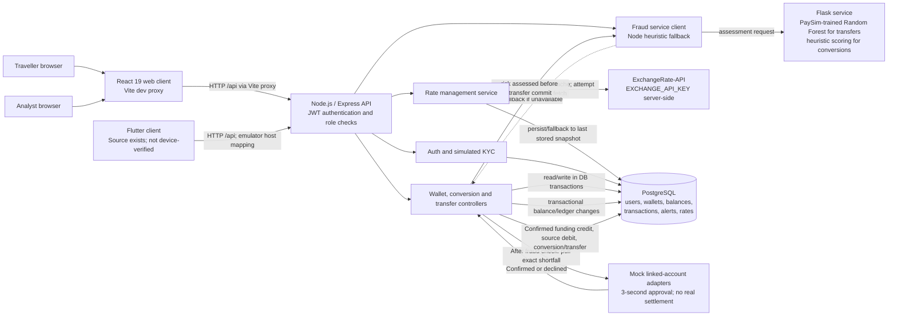
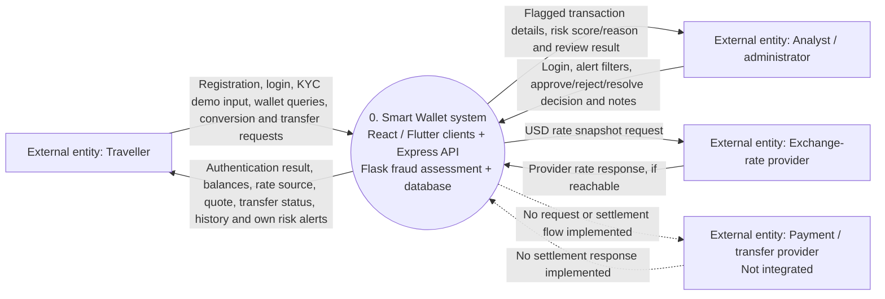
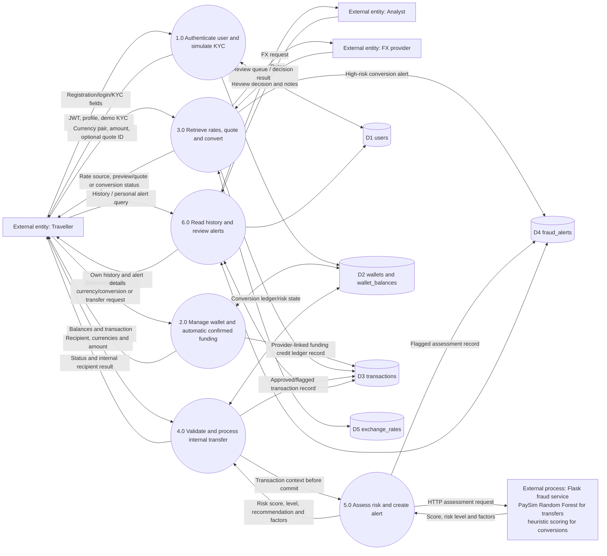
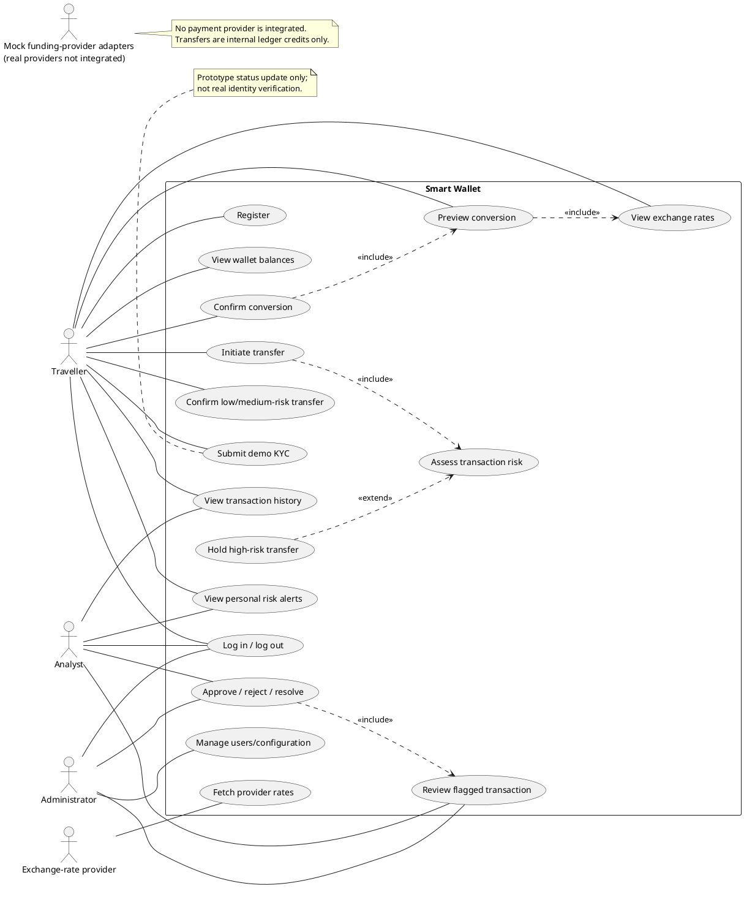

# Smart Wallet System Diagrams

These diagrams represent the inspected implementation. Dashed/future components are not currently integrated.

## System Architecture



## DFD Level 0: Context



## DFD Level 1: Main Processes and Stores



Process 5 is an internal Express-to-Flask call when Flask is reachable; otherwise Express uses its Node heuristic fallback. There is no external payment settlement process. A high-risk transfer debits/reserves source funds and is marked `FLAGGED`; analyst approval completes/releases it, while rejection marks it `REJECTED` and refunds the sender.

## UML Use Case Diagram

PlantUML is used here to show standard UML actors, system boundary, and relationships.



## Entity-Relationship Diagram

```mermaid
erDiagram
  USERS ||--o| WALLETS : owns
  WALLETS ||--|{ WALLET_BALANCES : contains
  USERS ||--o{ TRANSACTIONS : initiates
  WALLETS ||--o{ TRANSACTIONS : records
  TRANSACTIONS ||--o| FRAUD_ALERTS : may_raise
  USERS o|--o{ FRAUD_ALERTS : reviews

  USERS {
    uuid id PK
    string name
    string email UK
    string password_hash
    string role
    string kyc_status
    int kyc_tier
    decimal daily_limit_usd
    string id_document_type
    string id_document_number
  }
  WALLETS {
    uuid id PK
    uuid user_id FK_UK
    string default_currency
  }
  WALLET_BALANCES {
    uuid id PK
    uuid wallet_id FK
    string currency
    decimal balance
  }
  TRANSACTIONS {
    uuid id PK
    uuid user_id FK
    uuid wallet_id FK
    string transaction_type
    string source_currency
    string destination_currency
    decimal source_amount
    decimal converted_amount
    decimal exchange_rate
    string status
    decimal fraud_risk_score
    string fraud_risk_level
    json risk_factors
  }
  FRAUD_ALERTS {
    uuid id PK
    uuid transaction_id FK
    decimal risk_score
    string risk_level
    string review_status
    uuid reviewed_by FK
    datetime reviewed_at
    text reason
  }
  EXCHANGE_RATES {
    uuid id PK
    string base_currency
    string currency
    decimal rate
    string source
    datetime fetched_at
  }
```

A user's KYC state is stored on `users`, not in a separate KYC table. Country/provider linked sources are stored in `linked_accounts`; funding transactions reference the source and provider reference. Unique constraints apply to `(wallet_id, currency)` and `(base_currency, currency)`. Fraud assessment details are attached to transactions; review state is in `fraud_alerts`. The mock gateway adapters do not represent real payment-provider settlement tables.
